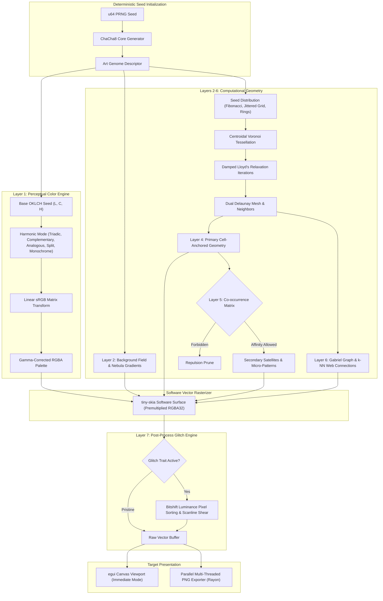

# Neo-Art — 7-Layer Procedural Abstract Background Studio

[](https://www.rust-lang.org/)
[](https://github.com/emilk/egui)
[](https://github.com/RazrFalcon/tiny-skia)
[](https://github.com/rayon-rs/rayon)
[](LICENSE)
[](#the-7-layer-procedural-pipeline)

A high-performance Rust procedural graphics engine and desktop studio for synthesizing production-grade abstract wallpapers, digital backdrops, and generative compositions. Neo-Art unites computational geometry (Centroidal Voronoi Tessellation, Delaunay Triangulation, Gabriel Graphs), perceptual color science ($OKLCH$), and a rule-based Co-occurrence Compatibility Matrix to generate visually balanced, high-resolution artwork without neural artifacts.

---

## Generative Philosophy & Creative Engineering

Traditional generative systems often suffer from either excessive randomness (yielding chaotic visual noise) or rigid repetition (yielding predictable patterns). **Neo-Art** resolves this tension through a deterministic, 7-layer architectural pipeline:

1. **Perceptually Uniform Color Space**: Palettes are resolved in $OKLCH$ to maintain consistent perceptual lightness and chroma transitions across harmonious modes, avoiding the muddy brown/grey midpoint trap of naive RGB/HSV interpolation.
2. **Organic Geometric Substrates**: Cell seeds generated via Poisson jitter, golden spirals, or orbital rings undergo damped **Lloyd's relaxation** to achieve structural equilibrium before graphic elements are instantiated.
3. **Rule-Based Aesthetic Coherence**: A **Co-occurrence Compatibility Matrix** enforces mathematical affinity and repulsion constraints between geometric primitives, preventing stylistic discordance (e.g., forbidding curved golden spirals within rigid Bauhaus grids).
4. **Isotropic Aspect Ratio Invariance**: Geometry is mathematically anchored using normalized isotropic projections, guaranteeing that circles stay true circles and stroke widths maintain visual weight across 16:9, 9:16 mobile story, 21:9 ultrawide, and square aspect ratios.

```
+---------------------------------------------------------------------------------------------------+
|                                  NEO-ART GENERATIVE PIPELINE                                      |
+---------------------------------------------------------------------------------------------------+
|  [64-bit Seed]  -->  ChaCha8Rng Deterministic Synthesis                                          |
|         |                                                                                         |
|         v                                                                                         |
|  +---------------------+   +---------------------+   +-----------------------------------------+  |
|  | Layer 1: OKLCH      |   | Layer 2: Background |   | Layer 3: Cellular Math Substrate        |  |
|  | 14 Palettes         |   | Field (Nebula /     |   | Voronoi Cells * Delaunay Dual Mesh      |  |
|  | 5 Harmonic Offsets  |   | Blueprint / Void)   |   | Lloyd Centroid Relaxation * Worley F2-F1|  |
|  +---------------------+   +---------------------+   +-----------------------------------------+  |
|                                                                   |                               |
|                                                                   v                               |
|  +-----------------------------------------+         +-----------------------------------------+  |
|  | Layer 5: Co-occurrence Compatibility    | <------ | Layer 4: Primary Geometry Anchors       |  |
|  | Affinity & Repulsion Matrix Constraints |         | Bauhaus / Concentric Rings / Prisms     |  |
|  +-----------------------------------------+         +-----------------------------------------+  |
|         |                                                                                         |
|         v                                                                                         |
|  +-----------------------------------------+   +-----------------------------------------------+  |
|  | Layer 6: Spatial Proximity Networks     |   | Layer 7: Post-Rasterization Glitch            |  |
|  | Gabriel Graphs / k-NN Laser Webs        |   | Luminance Pixel Sorting & Scanline Shear      |  |
|  +-----------------------------------------+   +-----------------------------------------------+  |
|         |                                              |                                          |
|         +-----------------------+----------------------+                                          |
|                                 |                                                                 |
|                                 v                                                                 |
|                 [tiny-skia 2D Vector Rasterizer]                                                  |
|                                 |                                                                 |
|               +-----------------+-----------------+                                               |
|               |                                   |                                               |
|               v                                   v                                               |
|       [egui Native Studio]             [Rayon Headless Batch]                                     |
|    Interactive Viewport & Canvas     Multi-Core 4K/FHD/UHD Export                                 |
+---------------------------------------------------------------------------------------------------+
```

---

## System Architecture



---

## The 7-Layer Procedural Pipeline & Mathematical Foundations

### Layer 1: Perceptual OKLCH Color Engine

Human color perception does not scale linearly with RGB values. Standard RGB or HSV hue shifting causes perceived brightness and saturation spikes (yellow appears jarringly brighter than blue at equal nominal values). Neo-Art calculates all palette harmonies in **OKLCH** (Lightness, Chroma, Hue angle) before resolving down to linear LMS cone space and gamma-corrected sRGB:

$$\begin{aligned}
a &= C \cdot \cos(\theta_h), \quad b = C \cdot \sin(\theta_h) \\
\begin{bmatrix} l' \\ m' \\ s' \end{bmatrix} &= \begin{bmatrix} 1.0 & +0.39633778 & +0.21580376 \\ 1.0 & -0.10556135 & -0.06385417 \\ 1.0 & -0.08948418 & -1.29148554 \end{bmatrix} \begin{bmatrix} L \\ a \\ b \end{bmatrix} \\
LMS &= \left( (l')^3, \; (m')^3, \; (s')^3 \right) \\
\begin{bmatrix} R_{\text{lin}} \\ G_{\text{lin}} \\ B_{\text{lin}} \end{bmatrix} &= \begin{bmatrix} +4.07674166 & -3.30771159 & +0.23096993 \\ -1.26843800 & +2.60975740 & -0.34131938 \\ -0.00419609 & -0.70341861 & +1.70761470 \end{bmatrix} \begin{bmatrix} L \\ M \\ S \end{bmatrix}
\end{aligned}$$

- **14 Algorithmic Palettes**: *Cyber Obsidian*, *Solar Flare*, *Acid Bauhaus*, *Bioluminescent Abyss*, *Monolith Bone*, *Ultraviolet Brutalism*, *Infrared Quartz*, *Glacier Carbon*, *Synthwave Rust*, *Emerald Matrix*, *Chromatic Void*, *Golden Ratio*, *Subzero Cobalt*, and *Plasma Opal*.
- **5 Harmonic Modes**:
  - *Complementary* ($\Delta\theta = [0^\circ, 180^\circ, 15^\circ, 195^\circ, 345^\circ]$)
  - *Triadic* ($\Delta\theta = [0^\circ, 120^\circ, 240^\circ, 60^\circ, 300^\circ]$)
  - *Split-Complementary* ($\Delta\theta = [0^\circ, 150^\circ, 210^\circ, 30^\circ, 180^\circ]$)
  - *Analogous* ($\Delta\theta = [0^\circ, 28^\circ, 332^\circ, 56^\circ, 304^\circ]$)
  - *Monochrome Accent* ($\Delta\theta = [0^\circ, 4^\circ, 356^\circ, 8^\circ, 180^\circ]$)

---

### Layer 2: Vector Background Field & Quantum Noise

Establishes spatial depth before geometric tessellation:
- **Deep Void**: Near-black perceptual field with microscopic luminescent gradient falloff.
- **Radial Nebula Gradient**: Multi-stop OKLCH radial glow positioned dynamically using seed coordinates.
- **Linear Horizon**: Atmospheric gradient along diagonal or cardinal visual vectors.
- **Micro Blueprint Grid**: High-precision engineering lines with sub-pixel alpha falloff.
- **Quantized Noise Field**: Octave-filtered Perlin/Simplex gradient noise quantized into discrete stepped luminance contours.
- **Dual-Tone Diagonal**: Angled high-contrast split supporting asymmetric visual tension.
- **Concentric Pulse**: Harmonic background ripples radiating from an off-center geometric attractor.

---

### Layer 3: Cellular Math Substrate

The spatial organization of each composition is driven by computational geometry:

1. **Seed Lattice Distributions**:
   - *Poisson Jittered Grid*: Regular grid perturbed by Gaussian noise vectors.
   - *Golden Fibonacci Spiral*: Cylindrical lattice based on golden angle $\phi \approx 137.5077^\circ$:
     $$r_i = \sqrt{\frac{i}{N}}, \quad \theta_i = i \cdot \frac{2\pi}{\phi^2}$$
   - *Clustered Nuclei*: Clustered gravity seeds forming organic cellular metropolitan zones.
   - *Harmonic Orbital Rings*: Multi-tiered concentric orbital shells with randomized angular step offsets.
2. **Voronoi Tessellation & Dual Delaunay Triangulation**:
   Generates convex polygonal partitions $V_i = \{ x \in \mathbb{R}^2 \mid \|x - p_i\| \le \|x - p_j\| \; \forall j \ne i \}$ alongside the dual Delaunay planar graph.
3. **Centroidal Voronoi Tessellation via Damped Lloyd's Relaxation**:
   Raw Voronoi diagrams often produce awkward, razor-thin sliver cells. Lloyd's algorithm iteratively migrates each seed $p_i$ toward its cell polygon centroid $C_i$:
   $$C_i = \frac{1}{6 A_i} \sum_{k=0}^{m-1} (\vec{v}_k + \vec{v}_{k+1}) (x_k y_{k+1} - x_{k+1} y_k), \quad A_i = \frac{1}{2} \sum_{k=0}^{m-1} (x_k y_{k+1} - x_{k+1} y_k)$$
   Neo-Art applies damped relaxation steps ($\alpha = 0.75$) with boundary clamps, producing harmonious, crystalline cellular geometry.
4. **Worley $F_2 - F_1$ Distance Ridge Fields**:
   Calculates Euclidean distances to the closest ($F_1$) and second closest ($F_2$) seed sites, generating sharp crystalline boundary ridges where $F_2 - F_1 \to 0$.

---

### Layer 4: Cell-Anchored Primary Geometry

Each relaxed Voronoi cell hosts a primary structural anchor scaled proportionally to the cell's maximum inscribed circle (inradius $r_{\text{in}}$):
- **Concentric Rings**: Multi-tiered precision line arcs with alternating stroke widths.
- **Inscribed Regular Polygons**: Triangles, Pentagons, Hexagons, and Octagons rotated relative to neighboring centroid vectors.
- **Bauhaus Rectilinear Blocks**: Modular orthogonal solids honoring 20th-century constructive minimalism.
- **Isometric Prisms**: 2.5D pseudo-isometric cubes shaded across three OKLCH lightness levels.
- **Radial Vector Bursts**: High-frequency directional ray arrays projecting from the seed nucleus.
- **Sacred Triangles**: Nested Keplerian equilateral geometries with golden ratio scale factors.
- **Harmonic Segmented Arcs**: Circular arcs partitioned into prime angular steps ($3, 5, 7, 12$).

---

### Layer 5: The Co-occurrence Compatibility Matrix

To avoid chaotic visual collisions, Layer 5 filters secondary geometry through a strict **Co-occurrence Compatibility Matrix**. Pairings have explicit conditional weights, and conflicting combinations have a weight of zero (strict repulsion).

| Primary Geometry | Orbital Micro-Dots | Nested Sub-Fractals | Crosshair Markers | Parallel Hatching | Golden Spiral Arcs | Vertex Satellites | Pure Minimalist |
| :--- | :---: | :---: | :---: | :---: | :---: | :---: | :---: |
| **Concentric Rings** | 35 (Synergy) | 0 (Forbidden) | 25 | 0 (Forbidden) | 22 | 12 | 6 |
| **Inscribed Polygons** | 12 | 34 (Synergy) | 0 (Forbidden) | 20 | 0 (Forbidden) | 28 | 6 |
| **Bauhaus Rectilinear**| 8 | 20 | 30 | 36 (Synergy) | 0 (Forbidden) | 0 (Forbidden) | 6 |
| **Isometric Prisms** | 20 | 0 (Forbidden) | 26 | 12 | 0 (Forbidden) | 38 (Synergy) | 4 |
| **Radial Vector Bursts**| 34 (Synergy) | 0 (Forbidden) | 12 | 0 (Forbidden) | 28 | 22 | 4 |
| **Sacred Triangles** | 0 (Forbidden) | 35 (Synergy) | 18 | 12 | 0 (Forbidden) | 30 | 5 |
| **Harmonic Arcs** | 32 | 0 (Forbidden) | 16 | 10 | 38 (Synergy) | 0 (Forbidden) | 4 |

---

### Layer 6: Spatial Proximity & Graph Networks

Constructs macroscopic connective tissue linking discrete cell anchors:

- **Gabriel Graph Network**:
  An edge between sites $p_i$ and $p_j$ exists if and only if the circle with diameter $\overline{p_i p_j}$ contains no other site $p_k$:
  $$\forall k \notin \{i, j\}, \quad \left\| p_k - \frac{p_i + p_j}{2} \right\|^2 \ge \left\| \frac{p_i - p_j}{2} \right\|^2$$
  Produces clean, non-intersecting laser bridges without the geometric density clutter of full Delaunay tessellations.
- **$k$-Nearest Neighbor ($k$-NN) Constellation Webs**: Euclidean distance laser trusses connecting proximity clusters.
- **Euclidean Distance-Threshold Laser Bridges**: Connects sites strictly within a calibrated distance window $[d_{\min}, d_{\max}]$.
- **Harmonic Interference Ripples**: Intersecting vector circles creating moiré visual interference patterns.
- **Magnetic Force Contours**: Field lines tracing virtual dipoles established across the composition's primary visual weight centroids.
- **Spatial Gravity Wells**: Concentric geodesic lines warped by seed mass concentrations.

---

### Layer 7: Post-Rasterization Glitch & Luminance Sorting

Post-rasterization pixel manipulations operating directly on RGBA8 framebuffers:

- **High-Speed Integer Luminance Calculation**:
  Approximates perceptual Rec. 709 luminance via fast integer bitshifts:
  $$Y_{\text{px}} = \frac{54 \cdot R + 183 \cdot G + 19 \cdot B}{256} \approx 0.2126 R + 0.7152 G + 0.0722 B$$
- **Horizontal & Vertical Luminance Pixel Sorting**:
  Scans pixel bands; when $Y_{\text{px}}$ enters the trigger threshold $[Y_{\text{low}}, Y_{\text{high}}]$, contiguous spans are sorted in place by luminance or hue, creating crystalline data streaking.
- **Scanline Slice Displacement**:
  Horizontally offsets pseudorandom pixel scanlines with wrapped boundary buffers, introducing cybernetic telemetry distortion.
- **Quantum Scanline Micro-Jitter**:
  Sub-pixel phase shifts applied across high-frequency vertical intervals.

---

## Isotropic Aspect Ratio Engine

Neo-Art eliminates stretched geometry when switching aspect ratios. The engine normalizes coordinates such that geometry renders with 1:1 circular metric tensors regardless of resolution:

```
Portrait (9:16)               Square (1:1)               Ultrawide (21:9)
+-------------+             +---------------+             +---------------------------+
|             |             |               |             |                           |
|      O      |             |       O       |             |             O             |
|   (Circle   |             |    (Circle    |             |          (Circle          |
|  preserved) |             |   preserved)  |             |         preserved)        |
|             |             |               |             |                           |
+-------------+             +---------------+             +---------------------------+
```

$$\text{bound}_x = \begin{cases} \text{aspect\_ratio}, & \text{if } \text{aspect\_ratio} \ge 1.0 \\ 1.0, & \text{otherwise} \end{cases}, \quad
\text{bound}_y = \begin{cases} 1.0, & \text{if } \text{aspect\_ratio} \ge 1.0 \\ \frac{1.0}{\text{aspect\_ratio}}, & \text{otherwise} \end{cases}$$

The density of Voronoi seed sites scales automatically with canvas surface area:

$$N_{\text{cells}} = \operatorname{clamp}\left(\operatorname{round}\left(N_{\text{base}} \cdot \sqrt{\text{bound}_x \cdot \text{bound}_y}\right), \; 8, \; 128\right)$$

Circles stay true circles, line stroke weights remain physically calibrated, and negative space is preserved seamlessly across 4K UHD, Mobile Stories, and Ultrawide displays.

---

## Interactive Studio GUI

Launch the native hardware-accelerated studio powered by `egui` and `eframe`:

```bash
cargo run --release
```

### Studio Capabilities
- **Live Reactive Viewport**: Immediate-mode canvas with real-time aspect ratio preview and continuous pan/zoom.
- **Canvas & Aspect Inspector**: Instant switching between presets (**4K UHD**, **1080p FHD**, **21:9 Ultrawide**, **9:16 Mobile Story**, **1:1 Square**, **4:3 Classic**) or custom pixel dimensions.
- **Palette & OKLCH Swatch Explorer**: Inspect active primary, secondary, stroke, and proximity glow color swatches.
- **Batch Browser Gallery**: Generate batches into memory, preview thumbnails, inspect underlying genome parameters, and selectively export high-resolution assets.
- **Direct Single Export**: Instantly render the active viewport to uncompressed, production-ready PNG.

---

## Headless CLI Batch Export

Generate hundreds of backgrounds across multiple cores without opening the GUI window:

```bash
# 50 4K UHD Wallpapers (16:9, 3840x2160)
cargo run --release -- --export-batch --count 50 --aspect 4k --output-dir output/4k

# 20 Full HD Wallpapers (16:9, 1920x1080)
cargo run --release -- --export-batch --count 20 --aspect 1080p --output-dir output/fhd

# 30 Mobile Story Wallpapers (9:16, 1080x1920)
cargo run --release -- --export-batch --count 30 --aspect 9:16 --output-dir output/mobile

# 15 Ultrawide Wallpapers (21:9, 3440x1440)
cargo run --release -- --export-batch --count 15 --aspect ultrawide --output-dir output/ultrawide

# 25 Square Avatars / Artwork (1:1, 2048x2048) with custom seed and prefix
cargo run --release -- --export-batch --count 25 --aspect 1:1 --seed 424242 --prefix avatar --output-dir output/avatars

# Custom dimensions and target directory
cargo run --release -- --export-batch --count 10 --width 5120 --height 2880 --prefix imac5k --output-dir output/5k
```

### Supported CLI Flags
| Flag | Type | Default | Description |
| :--- | :--- | :--- | :--- |
| `--export-batch` | Flag | `false` | Enables headless CLI export mode. |
| `--count` | Integer | `50` | Number of unique backgrounds to generate. |
| `--aspect` | String | `16:9` | Preset: `4k`, `1080p`, `fhd`, `9:16`, `mobile`, `21:9`, `ultrawide`, `1:1`, `square`, `4:3`. |
| `--width` | Integer | `3840` | Custom raster width (overrides preset). |
| `--height` | Integer | `2160` | Custom raster height (overrides preset). |
| `--output-dir` | Path | `output` | Target folder for exported PNG images. |
| `--prefix` | String | `background` | Output filename prefix (`<prefix>_0001.png`). |
| `--seed` | Integer | `20261121` | Base PRNG seed for deterministic output reproduction. |

---

## Technical Stack & Performance Profile

| Component | Technology | Rationale & Architectural Advantage |
| :--- | :--- | :--- |
| **Language** | Rust 2021 Edition | Zero-cost abstractions, memory safety, and thread concurrency. |
| **Windowing & GUI** | `eframe` / `egui` (0.31) | Immediate-mode GUI with minimal overhead and instantaneous layout reflows. |
| **Vector Rasterizer** | `tiny-skia` (0.11) | Pure-Rust Skia subset; fully deterministic software rasterization independent of GPU drivers. |
| **Multithreading** | `rayon` (1.10) | Work-stealing parallel iterator pipeline scaling batch rendering across all CPU cores. |
| **PRNG Core** | `rand_chacha` (0.3) | Cryptographically robust ChaCha8 engine ensuring identical renders across OS platforms for a given seed. |
| **Color Science** | Custom OKLCH Engine | Perceptually uniform lightness, preventing chromatic muddying and desaturation bugs. |
| **Computational Math**| Custom Polygon Solver | Damped Lloyd's relaxation, Voronoi cell calculation, and Gabriel empty-disk checks. |

- **Zero-GPU Dependency**: Can be deployed seamlessly in headless Linux cloud instances, CI/CD runners, and Docker containers without Vulkan/OpenGL/X11 requirements.
- **Deterministic Reproducibility**: Any artwork can be reconstructed down to the exact bit by passing the same 64-bit integer seed and dimension parameters.

---

## License

This project is licensed under either of:
- [Apache License, Version 2.0](http://www.apache.org/licenses/LICENSE-2.0)
- [MIT License](http://opensource.org/licenses/MIT)

at your option.
